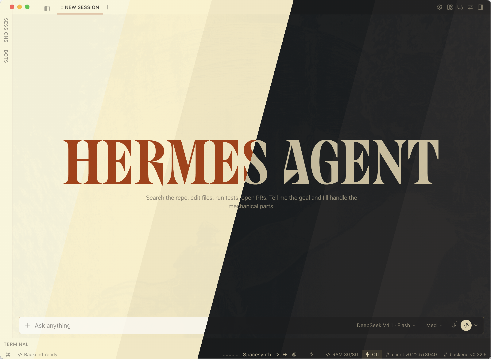
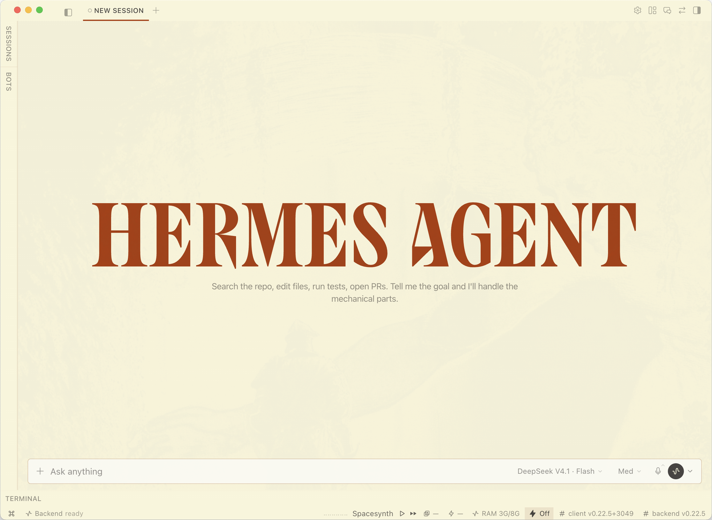
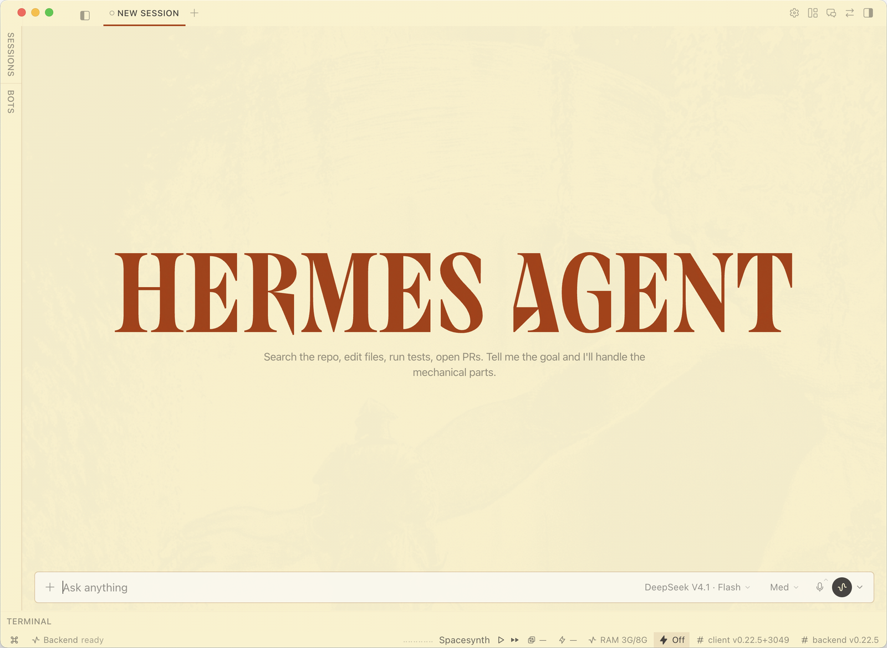
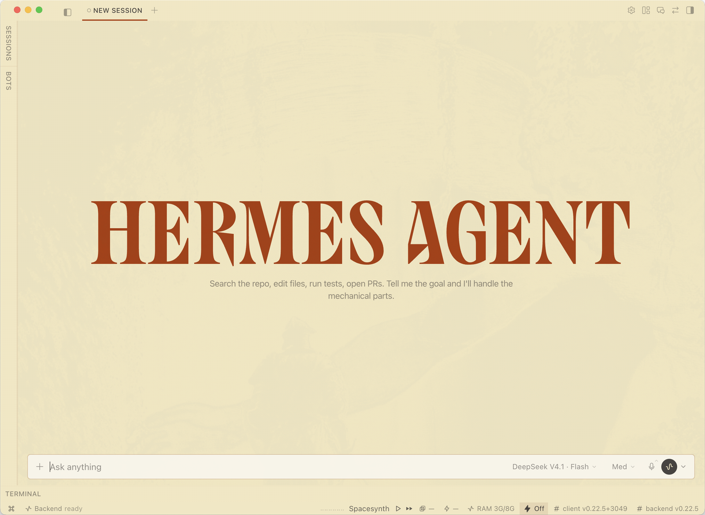
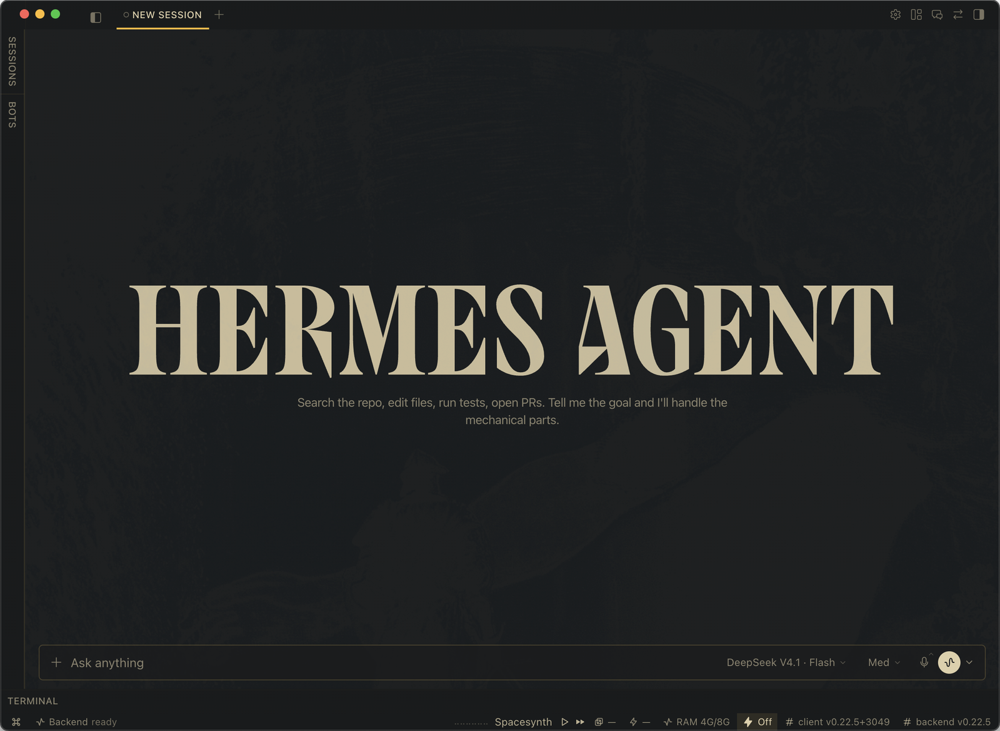
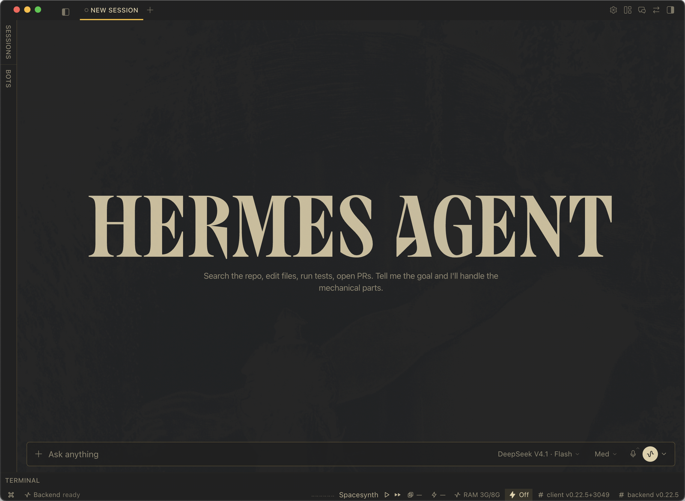
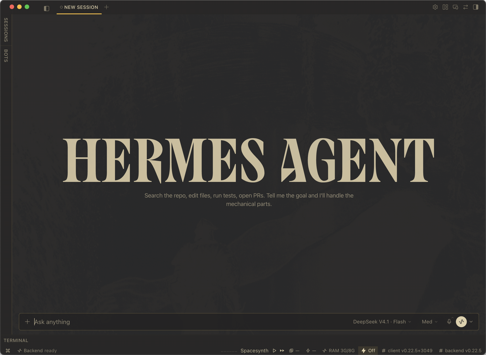

# hermes-gruvbox

Six Gruvbox themes for the Hermes Desktop app — Pavel Pertsev's
**[Gruvbox](https://github.com/morhetz/gruvbox)** in dark and light, each at hard,
medium and soft contrast. Installing the pack adds all six to the app's own theme
picker, with their real labels and descriptions.



## Installation

In the Desktop app: **Capabilities → Plugins** → **Install**, and paste
`AgileIndustrialComplex/hermes-gruvbox`. The page then lists a **Gruvbox Themes**
row — switch it on.

## Usage

**Settings → Appearance**, or **⌘K**, and pick one of the six:

```
Gruvbox Dark Hard
Gruvbox Dark Medium
Gruvbox Dark Soft
Gruvbox Light Hard
Gruvbox Light Medium
Gruvbox Light Soft
```

Picking one applies it to the Desktop straight away, exactly like a built-in theme.

## Screenshots

Each variant below is a full window, collapsed by default — expand for the whole
thing. All six are the same session, so flipping between them shows exactly what
the theme changes.

<details>
<summary><b>Gruvbox Light Hard</b> — Gruvbox, hard contrast: the brightest #f9f5d7 cream surface, dark ink, burnt-orange accents.</summary>



</details>

<details>
<summary><b>Gruvbox Light Medium</b> — Gruvbox, medium contrast: #fbf1c7 cream surface, dark ink, burnt-orange accents.</summary>



</details>

<details>
<summary><b>Gruvbox Light Soft</b> — Gruvbox, soft contrast: the warmest #f2e5bc cream surface, dark ink, burnt-orange accents.</summary>



</details>

<details>
<summary><b>Gruvbox Dark Hard</b> — Gruvbox, hard contrast: the deepest #1d2021 surface, cream text, yellow accents.</summary>



</details>

<details>
<summary><b>Gruvbox Dark Medium</b> — Gruvbox, medium contrast: #282828 surface, cream text, yellow accents.</summary>



</details>

<details>
<summary><b>Gruvbox Dark Soft</b> — Gruvbox, soft contrast: the lifted #32302f surface, cream text, yellow accents.</summary>



</details>

## Credits and license

The palettes are Pavel Pertsev's
**[Gruvbox](https://github.com/morhetz/gruvbox)**.

MIT — see [LICENSE](LICENSE).
